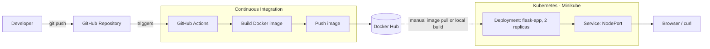
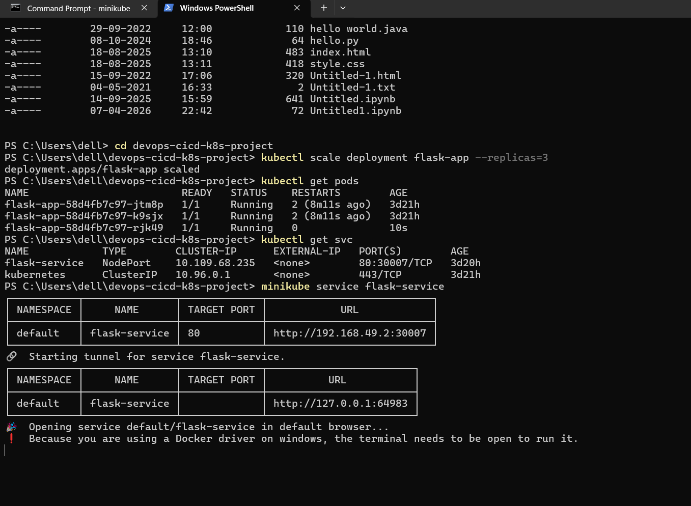

# End-to-End DevOps Pipeline: Flask on Kubernetes

A containerized Flask service with an automated image build pipeline (GitHub Actions to Docker Hub) and a Kubernetes deployment running on Minikube. The project documents the full path from application code to a running, scalable workload, including the failure modes encountered along the way.

## Table of Contents

- [Architecture](#architecture)
- [Tech Stack](#tech-stack)
- [Repository Structure](#repository-structure)
- [Application](#application)
- [Container Image](#container-image)
- [CI Pipeline](#ci-pipeline)
- [Kubernetes Deployment](#kubernetes-deployment)
- [Running Locally](#running-locally)
- [Design Decisions](#design-decisions)
- [Troubleshooting Log](#troubleshooting-log)
- [Current Limitations and Roadmap](#current-limitations-and-roadmap)

## Architecture



The CI stage is automated. The deployment stage is currently performed manually with `kubectl`, because GitHub-hosted runners cannot reach a local Minikube cluster. See [Current Limitations and Roadmap](#current-limitations-and-roadmap).

## Tech Stack

| Layer | Tool |
|---|---|
| Application | Python 3.12, Flask 3 |
| WSGI server | Gunicorn |
| Containerization | Docker |
| CI | GitHub Actions |
| Registry | Docker Hub |
| Orchestration | Kubernetes (Minikube) |

## Repository Structure

```
.
├── .github/workflows/
│   └── main.yml            # CI workflow: build and push image
├── app/
│   └── app.py              # Flask application
├── k8s/
│   ├── deployment.yaml     # Deployment manifest
│   └── service.yaml        # NodePort Service manifest
├── Dockerfile
├── requirements.txt
├── .dockerignore
└── pods-output.png         # Screenshot of running pods
```

## Application

A minimal Flask service exposing two endpoints:

| Endpoint | Purpose |
|---|---|
| `/` | Returns the application banner and version string |
| `/health` | Returns `{"status": "OK"}`; intended for liveness and readiness checks |

## Container Image

The image is built from `python:3.12-slim` with the following properties:

- **Production server.** The application runs under Gunicorn (2 workers) instead of Flask's development server.
- **Non-root execution.** The process runs as `appuser` (UID 10001), which limits the impact of a container compromise.
- **Layer caching.** `requirements.txt` is copied and installed before the application code, so dependency layers are rebuilt only when dependencies change.
- **Clean runtime.** `PYTHONDONTWRITEBYTECODE` and `PYTHONUNBUFFERED` are set so no bytecode is written and logs stream directly to the container output.

Verify non-root execution:

```bash
docker run --rm flask-app:test whoami
# appuser
```

## CI Pipeline

The workflow in `.github/workflows/main.yml` runs on pushes to `main`. It:

1. Checks out the repository.
2. Authenticates to Docker Hub using repository secrets (`DOCKERHUB_USERNAME`, `DOCKERHUB_TOKEN`).
3. Builds the Docker image.
4. Pushes the image to Docker Hub.

Registry credentials are stored as GitHub encrypted secrets and are never committed to the repository.

## Kubernetes Deployment

| Resource | Details |
|---|---|
| Deployment `flask-app` | 2 replicas, container port 5000 |
| Service `flask-service` | NodePort, exposes the Deployment outside the cluster |

The Deployment currently uses the locally built image `flask-app:v2` with `imagePullPolicy: Never`, so the image must exist inside the Minikube node before applying the manifests. See [Running Locally](#running-locally).



## Running Locally

**Prerequisites:** Docker, Minikube, kubectl.

**1. Clone the repository**

```bash
git clone https://github.com/Tanvi-s26/end-to-end-devops-pipeline-k8s.git
cd end-to-end-devops-pipeline-k8s
```

**2. Run the container on its own (optional smoke test)**

```bash
docker build -t flask-app:test .
docker run -d -p 5000:5000 --name flask-test flask-app:test
curl http://localhost:5000/health
docker rm -f flask-test
```

Allow a few seconds after `docker run` for Gunicorn to finish starting before sending the request.

**3. Deploy to Minikube**

```bash
minikube start
minikube image build -t flask-app:v2 .
kubectl apply -f k8s/
kubectl get pods
```

**4. Access the service**

```bash
minikube service flask-service --url
```

**5. Scale the deployment**

```bash
kubectl scale deployment flask-app --replicas=4
kubectl get pods
```

**6. Roll out a new version**

```bash
minikube image build -t flask-app:v3 .
kubectl set image deployment/flask-app flask-container=flask-app:v3
kubectl rollout status deployment/flask-app
```

## Design Decisions

**Gunicorn instead of the Flask development server.** The built-in server is single-purpose tooling for development and is not intended to handle production traffic.

**Non-root container user.** Running as an unprivileged user is a baseline container hardening practice and a common requirement of cluster security policies.

**Versioned image tags instead of `latest`.** Kubernetes only rolls out a change when the Pod template changes. Re-pushing `latest` leaves the manifest unchanged, so no rollout happens and nodes may keep serving a cached image. A new tag changes the template and triggers a controlled rolling update.

**NodePort Service.** NodePort is sufficient for a single-node Minikube cluster. A cloud deployment would use a LoadBalancer Service or an Ingress controller.

## Troubleshooting Log

| Symptom | Root cause | Resolution |
|---|---|---|
| New code not visible after redeploy | Image tag unchanged (`latest`), so the Deployment spec did not change and the node reused its cached image | Switched to explicit version tags and `kubectl rollout restart` |
| `kubectl apply` failed on a root-level manifest | The file contained only a `containers:` fragment, with no `apiVersion`, `kind` or `metadata` | Removed the duplicate and kept a single complete manifest under `k8s/` |
| `curl` returned "Empty reply from server" right after `docker run` | The port was published before Gunicorn had finished booting | Waited for readiness; this behavior is the motivation for adding readiness probes |
| GitHub Actions could not deploy to the cluster | Hosted runners cannot reach a Minikube instance on a local machine | Scoped CI to build and push; automated deployment to a reachable cluster is on the roadmap |

## Current Limitations and Roadmap

This repository demonstrates the build and deploy workflow. The following items are known gaps and the planned next work:

- [ ] Add liveness and readiness probes (using `/health`), resource requests and limits, and an explicit rolling update strategy to the Deployment
- [ ] Add automated tests and linting to the CI workflow
- [ ] Add container image vulnerability scanning (Trivy) as a CI gate
- [ ] Tag images with the commit SHA instead of manual version tags
- [ ] Automate deployment from the pipeline to a cluster reachable from CI
- [ ] Add monitoring with Prometheus and Grafana